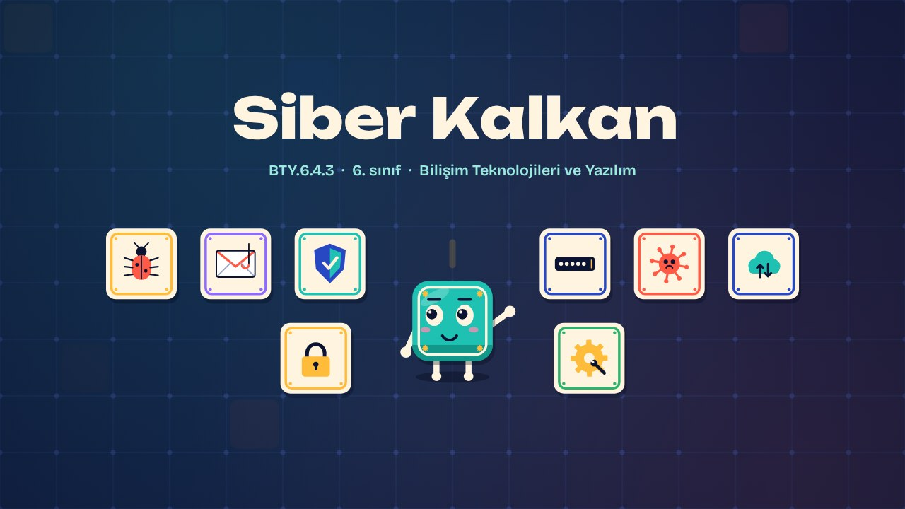
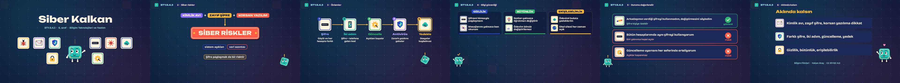

# Siber Kalkan · Cyber Shield

**▶ Tarayıcıda izleyin / Watch in the browser:** https://hakanatas.github.io/siber-kalkan/ 
**⬇ MP4 + altyazılar / MP4 + subtitles:** [Releases](https://github.com/hakanatas/siber-kalkan/releases) 
**✎ Kullanılan istem / The prompt behind it:** [PROMPT.md](PROMPT.md) 
**🎞 Bütün filmler / All films:** [Bilişim Filmleri](https://hakanatas.github.io/bilisim-filmleri/?sinif=6)

> **TR —** 6. sınıf Bilişim Teknolojileri ve Yazılım dersinin "Bilişim Etiği ve Siber Güvenlik" temasındaki BTY.6.4.3 öğrenme çıktısı için hazırlanmış, tamamen JavaScript ile çizilen 2,3 dakikalık animasyon; ses efektleri ve hafif fon müziği de kodla üretilir. Siber ortamdaki güvenlik riskleri tanıtılır: kimlik avı, zayıf şifreyle hesap ele geçirme, korsan yazılımla yayılan zararlı yazılımlar ve sistem açıklarından veri sızdırma. Güçlü ve farklı şifreler, iki adımlı doğrulama, güncelleme, antivirüs ve yedekleme gibi önlemler sıralanır. Bilgi güvenliğinin temel bileşenleri (gizlilik, bütünlük, erişilebilirlik) günlük örneklerle ayırt edilir. Son olarak "arkadaşım şifresini bana verdi" senaryosu ve benzer durumlar güvenlik önlemleri açısından değerlendirilir. Altyazılar Türkçe, İngilizce ya da ikisi birlikte seçilebilir.

A 2.3-minute animation, with code-generated sound, for **6th-grade IT and Software** (Türkiye Yüzyılı Maarif Modeli). Cyber risks (phishing, weak passwords, malware from pirated software, leaks through system flaws) and protections (strong unique passwords, two-step verification, updates, antivirus, backups) are introduced; confidentiality, integrity and availability are told apart; and a "my friend gave me his password" scenario is judged. The guide is **Karo**, a living glazed tile who never speaks: he tells the story with his face, his arms and the blinking cursor above his head.

## Öğrenme çıktısı · Learning outcome

MEB, Türkiye Yüzyılı Maarif Modeli, Bilişim Teknolojileri ve Yazılım Dersi Öğretim Programı, 6. sınıf, 4. tema "Bilişim Etiği ve Siber Güvenlik":

**BTY.6.4.3. Siber ortamda güvenlik önlemlerini yönetebilme**
- a) Siber ortamda güvenlik risklerini belirler.
- b) Siber ortamda güvenlik önlemlerini belirler.
- c) Siber ortamda bilgi güvenliğinin temel bileşenlerini ayırt eder.
- ç) Siber ortamdaki örnek bir durumu güvenlik önlemleri açısından değerlendirir.

## Sahneler · Scenes

| # | Zaman | Sahne | Ne oluyor | Çıktı |
|---|---|---|---|---|
| 1 | 0:00–0:16 | Giriş |  |  |
| 2 | 0:16–0:47 | Siber riskler | Kimlik avı, zayıf şifre, korsan yazılım; sistem açıkları ve veri sızıntısı. | a |
| 3 | 0:47–1:11 | Önlemler | Güçlü ve farklı şifreler, iki adımlı doğrulama, güncelleme, antivirüs, yedekleme. | b |
| 4 | 1:11–1:40 | Bilgi güvenliği | Gizlilik, bütünlük ve erişilebilirlik ayırt edilir. | c |
| 5 | 1:40–2:02 | Durumu değerlendir | Siber ortamdaki örnek durumlar güvenlik önlemleri açısından değerlendirilir. | ç |
| 6 | 2:02–2:17 | Aklında kalsın |  |  |

## Çalıştırma · Running it

- **Önizleme:** `index.html` dosyasına çift tıklayın (çevrim dışı da çalışır). Klavye: boşluk oynat/duraklat, ← → 3 sn, Home başa. Adrese `?altyazi=en`, `?bicim=vertical` ya da `?ses=0` eklenebilir.
- **MP4:** bir kez `npm install`, sonra `npm run export -- --format=both --captions=tr` (720p yatay ve dikey, sesli). Google Chrome yüklüyse Playwright onu kullanır (`channel: 'chrome'`); ffmpeg gerekir.
- **Altyazı ve seslendirme notları:** `npm run srt` → `out/siber-kalkan_tr.srt`, `_en.srt`, `_tr-en.srt`, `_seslendirme-notlari.txt`.
- **Sürüm dosyaları:** `npm run release` → `release/` klasöründe v1.0'ın 6 dosyası.
- **Yazı kontrolü:** `npm run check` yatay ve dikey düzende, üç altyazı seçeneğiyle üst üste binen, kenardan taşan ya da 720p'de 17 pikselden küçük kalan yazı arar.
- **Düzenleme:** senaryo (sahneler, altyazılar, seslendirme notları) `scenes/film.js` içindedir; değiştirince `npm run build` süreleri, `captions.js` ve `film.config.js` dosyalarını yeniden üretir. Sahne şablonları `src/kit/`, Karo `src/draw/karo.js`, ses `src/audio/synth.js`.

Her kare `renderFrame(t)` ile zamanın saf fonksiyonu olarak çizilir; rastgelelik tohumludur, MP4 ekran kaydı değil kare kare üretimdir. Ses de dosyadan çalınmaz: aynı olay listesinden hesaplanır. Yazı tipleri: Unbounded ve Bricolage Grotesque (SIL OFL 1.1), dosyaya gömülü.

## Lisans · License

**TR —** Bu film ve kodu [Creative Commons Atıf-GayriTicari 4.0 Uluslararası (CC BY-NC 4.0)](https://creativecommons.org/licenses/by-nc/4.0/deed.tr) lisansıyla paylaşılır. Ticari olmayan her amaçla (derste, okulda, eğitim materyalinde) kopyalayabilir, paylaşabilir ve değiştirebilirsiniz; ancak **kaynak göstermek zorunludur**: eser sahibinin adı ve bu deponun bağlantısı belirtilmeden kullanılamaz. Ticari kullanım (satış, ücretli ürün ya da yayın) için izin alınmalıdır.

**EN —** This film and its code are licensed under [Creative Commons Attribution-NonCommercial 4.0 International (CC BY-NC 4.0)](https://creativecommons.org/licenses/by-nc/4.0/). You may copy, share and adapt them for non-commercial purposes, but **attribution is required**: they may not be used without crediting the author and linking to this repository. Commercial use requires permission.

Atıf örneği / Required credit: *“Siber Kalkan”, Hakan Ataş, Bilişim Filmleri — https://github.com/hakanatas/siber-kalkan — CC BY-NC 4.0*
